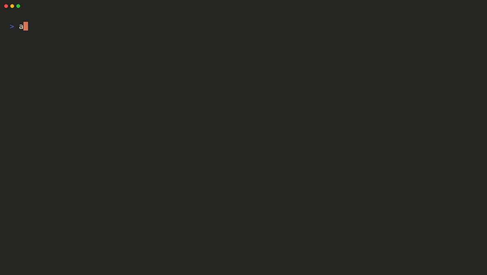

# ant — Claude Platform CLI

[](https://github.com/anthropics/anthropic-cli/releases)
[](https://github.com/anthropics/homebrew-tap)

`ant` is the official CLI for the [Claude Platform](https://platform.claude.com/docs/en/api). It puts the Claude API in your terminal — send messages, manage agents and sessions, upload files, and script against every API endpoint.



## Documentation

Full documentation is available at **[platform.claude.com/docs/en/api/sdks/cli](https://platform.claude.com/docs/en/api/sdks/cli)**.

## Installation

<!-- x-release-please-start-version -->

### Installing with Homebrew

```sh
brew install anthropics/tap/ant
```

### Installing with Go

To test or install the CLI locally, you need [Go](https://go.dev/doc/install) version 1.22 or later installed.

```sh
go install 'github.com/anthropics/anthropic-cli/v2/cmd/ant@latest'
```

Once you have run `go install`, the binary is placed in your Go bin directory:

- **Default location**: `$HOME/go/bin` (or `$GOPATH/bin` if GOPATH is set)
- **Check your path**: Run `go env GOPATH` to see the base directory

If commands aren't found after installation, add the Go bin directory to your PATH:

```sh
# Add to your shell profile (.zshrc, .bashrc, etc.)
export PATH="$PATH:$(go env GOPATH)/bin"
```

<!-- x-release-please-end -->

## Getting started

Log in with your Claude Console account:

```sh
ant auth login
```

Or set the `ANTHROPIC_API_KEY` environment variable to an API key from the [Claude Console](https://platform.claude.com/settings/keys).

To hand the CLI a key from a secret manager without putting it in the environment, pipe it on stdin:

```sh
op read op://vault/anthropic/api-key | ant --api-key-stdin models list
```

Then send your first message:

```sh
ant messages create \
  --max-tokens 1024 \
  --message '{role: user, content: "Hello, Claude"}' \
  --model claude-opus-5-5
```

Structured flags accept relaxed JSON or YAML, so unquoted keys are fine.

### Claude Models on Google Cloud (Anthropic managed)

Sign in with Google and name your workspace; the CLI then sends requests through the Google Cloud gateway and keeps the Google access token fresh:

```sh
gcloud auth application-default login

export ANTHROPIC_GOOGLE_CLOUD_PROJECT=my-project
export ANTHROPIC_GOOGLE_CLOUD_WORKSPACE_ID=wrkspc_...
ant models list
```

The same settings are available as `--google-cloud-project`, `--google-cloud-workspace-id` and `--google-cloud-location` (default `global`). The project defaults to the one your Google credentials carry. Any credentials Google's Application Default Credentials find are used, including a service account key named by `GOOGLE_APPLICATION_CREDENTIALS`. An API key, an auth token or a profile named with `--profile` takes precedence; `ant auth status` shows which is in use. Google credentials are sent only to the gateway: `--base-url` and `ANTHROPIC_BASE_URL` are not used, and `--google-cloud-base-url` (`ANTHROPIC_GOOGLE_CLOUD_BASE_URL`) overrides the gateway URL. `ant beta:worker` is not supported on Google Cloud.

### Claude Platform on AWS

Name your region and workspace; the CLI then sends requests through the Claude Platform on AWS gateway, signed with your AWS credentials:

```sh
export AWS_REGION=us-east-1
export ANTHROPIC_AWS_WORKSPACE_ID=wrkspc_...
ant models list
```

The same settings are available as `--aws-region` and `--aws-workspace-id`. Either flag, `ANTHROPIC_AWS_WORKSPACE_ID` or an AWS API key selects AWS; `AWS_REGION` and `AWS_PROFILE` on their own don't, since most AWS machines set them for other reasons. The region defaults to `AWS_REGION`, then `AWS_DEFAULT_REGION`. Any credentials the AWS default credential chain finds are used, including `AWS_PROFILE`, environment keys and an IAM role. To use an API key generated in the AWS Console instead, set `ANTHROPIC_AWS_API_KEY` or pipe it to `--aws-api-key-stdin`. The key works only in the region it was generated in, so set the region to match. `ANTHROPIC_API_KEY`, an auth token, a profile named with `--profile` or Google Cloud settings take precedence; `ant auth status` shows which is in use. AWS credentials are sent only to the gateway: `--base-url` and `ANTHROPIC_BASE_URL` are not used, and `--aws-base-url` (`ANTHROPIC_AWS_BASE_URL`) overrides the gateway URL. `ant beta:worker` is not supported on AWS.

### Claude in Microsoft Foundry

Name your resource and set an API key from the Foundry portal. The CLI then sends requests to that resource:

```sh
export ANTHROPIC_FOUNDRY_RESOURCE=my-resource
export ANTHROPIC_FOUNDRY_API_KEY=...
ant messages create \
  --max-tokens 1024 \
  --message '{role: user, content: "Hello, Claude"}' \
  --model claude-opus-5-5
```

`--model` takes the name of your deployment, which defaults to the model ID. To use Microsoft Entra ID instead of an API key, set an access token:

```sh
export ANTHROPIC_FOUNDRY_AUTH_TOKEN="$(az account get-access-token --resource https://ai.azure.com --query accessToken -o tsv)"
```

The CLI doesn't refresh the token, so set it again when it expires.

`--foundry-resource` also sets the resource, and `--foundry-api-key-stdin` and `--foundry-auth-token-stdin` read the key or the token from standard input. A key, a token or `--foundry-resource` selects Foundry; `ANTHROPIC_FOUNDRY_RESOURCE` on its own doesn't, since a Claude Code setup can export it with no key or token. When both a key and a token are set, the piped one is used; when both come from the environment, the token is used, as in Claude Code, and the CLI prints a note. `ANTHROPIC_API_KEY`, an auth token, a profile named with `--profile`, Google Cloud settings and AWS settings take precedence, and `ant auth status` shows which is in use. Foundry credentials are sent only to your resource, so `--base-url` and `ANTHROPIC_BASE_URL` are not used. `ANTHROPIC_CUSTOM_HEADERS` is not applied either. To send requests to another URL, set `--foundry-base-url` (`ANTHROPIC_FOUNDRY_BASE_URL`) in place of the resource, and include the `/anthropic` path. [Claude in Microsoft Foundry](https://platform.claude.com/docs/en/build-with-claude/claude-in-microsoft-foundry) lists the features available there. `ant beta:worker` is not supported on Foundry.

## Requirements

macOS, Linux, or Windows.

## Contributing

See [CONTRIBUTING.md](./CONTRIBUTING.md). The [`sandboxes/`](./sandboxes/README.md) directory, the pieces for running Claude Managed Agents self-hosted sandboxes, is a separate Go module with its own README.

## License

This project is licensed under the Apache License, Version 2.0. See the [LICENSE](LICENSE) file for details. Versions released before the change from the MIT License, and third-party contributions merged before it, remain under the MIT License. See [LICENSE-MIT](LICENSE-MIT).
